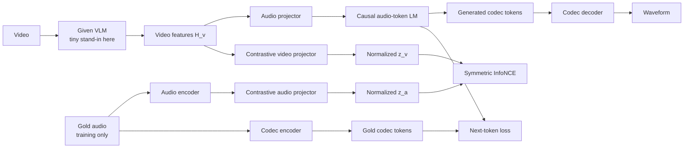

# Contrastive video-to-audio architecture

This document describes the **corrected spec** and the code in this folder. The model has two training objectives: symmetric video–audio InfoNCE for representation alignment, and teacher-forced codec-token prediction for audio generation. At inference, only the generation path is used. The supplied VLM, pretrained audio encoder, and pretrained codec are represented here by small stand-ins with random weights, so the runnable WAV demonstrates execution rather than sound quality.

For explanations of individual lines, open the [interactive walkthrough](walkthrough.html).

## 1. Whole-system map



The key separation is **two video projections from the same frozen VLM features**. `audio_projector` preserves a sequence of conditioning tokens for generation. `video_contrastive_projector` maps a pooled video representation into the shared video–audio embedding space. The gold waveform also takes two paths: its separate audio encoder supports InfoNCE, while its codec encoder supplies generation targets. No text prompt is used.

The implementation lives in [vlm.py](vlm.py), [audio_encoder.py](audio_encoder.py), [codec.py](codec.py), [model.py](model.py), and [test.py](test.py).

## 2. Symbols and demo settings

| Symbol | Meaning | Default or demo value |
|---|---|---:|
| `B` | Paired examples in a training batch | 2 for InfoNCE check |
| `N` | Video frames per clip | 4 |
| `H, W` | Input frame height and width | 32, 32 |
| `D_v` | VLM feature width | 64 |
| `D_a` | Audio-encoder feature width | 64 |
| `D_m` | Generative LM width | 64 |
| `D_c` | Shared contrastive embedding width | 64 |
| `K` | Codec codebooks | 2 |
| `S` | Token choices per codebook | 32 |
| `F` | Codec frames requested | 10 |
| `L` | Waveform samples | `320 × F = 3200` |
| `hop` | Samples per codec frame | 320 |
| `sample_rate` | Waveform samples per second | 16,000 Hz |

At 16 kHz, a 320-sample codec hop yields **50 codec frames per second**. With two codebooks, the LM predicts **100 token IDs per second**. The ten-frame demonstration returns 3200 samples, or **0.2 seconds**. `16_000` and `16000` are equal Python integer literals.

## 3. Frozen video feature extractor

The original spec assumes a **given pretrained VLM** returning `H_v` with shape `[B, N, D_v]`. Our `TinyCLIPVisionEncoder` is a random-weight stand-in for that interface. It processes each frame with 8×8 patches, one class token, learned patch positions, and two bidirectional visual Transformer layers. It is frozen inside `VideoToAudio`.

| Visual step | General shape | Demo shape |
|---|---|---|
| RGB video | `[B, N, 3, H, W]` | `[2, 4, 3, 32, 32]` |
| Treat frames as images; resize to 32×32 | `[B×N, 3, 32, 32]` | `[8, 3, 32, 32]` |
| Embed 8×8 patches | `[B×N, 64, 4, 4]` | `[8, 64, 4, 4]` |
| Flatten 16 patches | `[B×N, 16, 64]` | `[8, 16, 64]` |
| Add class token and positions | `[B×N, 17, 64]` | `[8, 17, 64]` |
| Read projected class token | `[B, N, D_v]` | `[2, 4, 64]` |

The visual stand-in mixes patches within each frame. The sequence of its frame embeddings is preserved for the audio LM. The word “CLIP-style” here describes its visual-tower layout; the **actual contrastive objective** is the separate InfoNCE branch below.

## 4. Golden audio and its two paths

Training receives a matching **mono 16-kHz** gold waveform `[B, 1, L]`. The two paths do different jobs:

1. `TinyAudioEncoder` produces continuous features for **video–audio InfoNCE**. It is trainable and is not called during generation.
2. `TinyCodec.encode()` produces discrete token IDs for the **autoregressive generation loss**. The codec is frozen.

### 4.1 Audio encoder for InfoNCE

`TinyAudioEncoder` uses three stride-4 one-dimensional convolutions. For `L=3200`, the lengths become 800, 200, then 50. The output is transposed into a sequence of audio features:

| Audio-encoder step | General shape | Demo shape |
|---|---|---|
| Gold waveform | `[B, 1, L]` | `[2, 1, 3200]` |
| Convolution 1 | `[B, 16, ceil(L/4)]` | `[2, 16, 800]` |
| Convolution 2 | `[B, 32, ceil(L/16)]` | `[2, 32, 200]` |
| Convolution 3 | `[B, D_a, ceil(L/64)]` | `[2, 64, 50]` |
| Transposed output `H_a` | `[B, ceil(L/64), D_a]` | `[2, 50, 64]` |

This is a small representative audio encoder, not a pretrained audio representation model.

### 4.2 Neural codec for generation targets

`TinyCodec` compresses the waveform with strides `4, 4, 4, 5`; their product is the 320-sample hop. Residual vector quantization selects one integer from each of two codebooks for every codec frame.

| Codec step | General shape | Demo shape |
|---|---|---|
| Gold waveform | `[B, 1, L]` | `[2, 1, 3200]` |
| Continuous codec latent | `[B, 32, F]` | `[2, 32, 10]` |
| Codebook vectors | `[K, S, 32]` | `[2, 32, 32]` |
| Discrete codes | `[B, K, F]` | `[2, 2, 10]` |

Each local code index is in `0…31`. The codec decoder performs the reverse operation: codes `[B, 2, 10]` select and sum vectors, and transpose convolutions produce `[B, 1, 3200]`. The **codec is random and frozen in this proof of concept**; it must be replaced with a pretrained codec for useful audio. It is separate from the contrastive audio encoder.

## 5. Contrastive branch: video–audio InfoNCE

The contrastive branch uses **global clip embeddings**, exactly as in the corrected spec. It does not compare individual video frames with individual codec tokens. The video features and audio-encoder features are pooled over their respective time axes, projected separately, and L2-normalized:

```text
H_v [B, N, 64]  → mean over N → [B, 64] → video_contrastive_projector → z_v [B, 64]
H_a [B, 50, 64] → mean over 50 → [B, 64] → audio_contrastive_projector → z_a [B, 64]
```

The projections are trainable. Normalization makes each row of `z_v` and `z_a` unit length. The similarity matrix is

`S = scale × (z_v @ z_a.T)`, with shape `[B, B]` (demo: `[2, 2]`).

The diagonal `S[i, i]` contains matching video–audio pairs. Off-diagonal entries are other clips in the batch and act as negatives. The learned scale starts at `1 / 0.07` and is capped at 100. Two cross-entropies implement symmetric InfoNCE:

```text
L_v→a = cross_entropy(S,     [0, 1, …, B−1])
L_a→v = cross_entropy(S.T,   [0, 1, …, B−1])
L_InfoNCE = (L_v→a + L_a→v) / 2
```

The batch must have **at least two paired clips**, since a single pair provides no in-batch negative. The pairs and their order must match across the video and waveform tensors. The audio encoder is trained by this loss; the frozen VLM is not, but its new video contrastive projector is.

## 6. Generative branch: codec-token Audio LM

The second branch independently learns `P(codec tokens | video)`. It projects **every** VLM frame feature into `D_m=64`, preserving `[B, N, 64]` as a video-conditioning prefix. The causal Transformer reads that prefix followed by earlier codec tokens and predicts the next token. The correct codebook is fixed by position: book 0, book 1, then the next codec frame.

The LM gives different input IDs to equal local indices from different codebooks:

| Input token | Full embedding ID |
|---|---:|
| Codebook 0, local index `c` | `c`, in `0…31` |
| Codebook 1, local index `c` | `32+c`, in `32…63` |
| Beginning-of-sequence token | `64` |

Its input embedding table therefore has shape `[65, 64]`. A separate linear output head scores the 32 **local** indices of the current codebook. Two 64-wide causal Transformer layers have four attention heads each. Their feed-forward width is 256.

### Teacher-forced training dimensions

| Generative step | General shape | Demo shape (`B=2, N=4, F=10`) |
|---|---|---|
| VLM features `H_v` | `[B, N, D_v]` | `[2, 4, 64]` |
| Gold codec codes | `[B, K, F]` | `[2, 2, 10]` |
| Frame-first target IDs | `[B, K×F]` | `[2, 20]` |
| Shifted input `[BOS, c₁, …, c₁₉]` | `[B, K×F]` | `[2, 20]` |
| Audio projector output `Z_v` | `[B, N, D_m]` | `[2, 4, 64]` |
| Embedded shifted tokens | `[B, K×F, D_m]` | `[2, 20, 64]` |
| Combined Transformer sequence | `[B, N+K×F, D_m]` | `[2, 24, 64]` |
| Scores for audio positions | `[B, K×F, S]` | `[2, 20, 32]` |
| Generation cross-entropy | Scalar | Scalar |

The causal mask prevents an audio position from seeing future audio tokens. Every audio position can see all earlier video-prefix tokens. Teacher forcing shifts the input by one token, so a position predicting `c_j` sees `BOS, c₁, …, c_(j−1)`, never `c_j`. The code uses the **mean** cross-entropy over positions and batch items; this is the averaged implementation of the spec's summed negative log-likelihood.

### Combined objective

`model.losses(video, waveform)` returns the named scalar values `generation`, `contrastive`, and `total`:

`L_total = L_gen + contrastive_weight × L_InfoNCE`.

The default `contrastive_weight` is `0.1`. `model.loss(video, waveform)` returns only `L_total` for a conventional optimizer loop. The generative objective updates the audio projector, token and position embeddings, Transformer, and output head. InfoNCE updates the video contrastive projector, audio encoder, audio contrastive projector, and contrastive scale. The given VLM and codec stay frozen.

The last boxed equation in the pasted spec calls the generation term `L_codec`; its earlier definition and combined-objective section call it `L_gen`. This implementation uses **`L_gen`** for codec-token generation loss, with no codec-training objective.

## 7. Inference dimensions

Inference receives **only video**. It does not call the audio encoder, contrastive projectors, codec encoder, or either loss. It generates a fixed number `F` of codec frames from `BOS`, choosing each next local index by greedy argmax when `temperature=0` or by sampling when temperature is positive.

| Inference step | General shape | Demo shape (`B=1`) |
|---|---|---|
| Input video | `[B, N, 3, H, W]` | `[1, 4, 3, 32, 32]` |
| VLM features | `[B, N, D_v]` | `[1, 4, 64]` |
| Audio projector prefix | `[B, N, D_m]` | `[1, 4, 64]` |
| Current LM scores | `[B, S]` | `[1, 32]` |
| All generated local IDs | `[B, K×F]` | `[1, 20]` |
| Codec decoder input | `[B, K, F]` | `[1, 2, 10]` |
| Floating waveform | `[B, 1, 320×F]` | `[1, 1, 3200]` |

`test.py` writes this waveform as mono 16-bit PCM WAV at 16 kHz. It checks that the shape is correct and samples are finite. The model has no end-of-audio token; the requested `audio_frames` sets duration.

## 8. Run the two checks

From this folder:

```bash
.venv/bin/python test.py
.venv/bin/python test.py --input my_video.pt --output my_audio.wav
.venv/bin/python test.py --check-loss
```

The optional input file is a `torch.save` tensor `[N, 3, H, W]` with float RGB values in `[0, 1]`; no MP4 decoding is included. The default uses four random 32×32 frames. `--check-loss` creates two synthetic pairs, computes **both** losses, calls `backward()` to verify their gradient paths, and performs **no optimizer step**. These synthetic pairs are not meaningful training data.

## 9. Scope and current limits

- The VLM, codec, and demonstration audio encoder have random weights. A substantive experiment needs suitable pretrained replacements and paired, synchronized video–audio data.
- The actual VLM and codec are outside the original implementation scope. Adapters must preserve their input/output shapes and token conventions.
- Clips within one batch currently need equal waveform lengths; there are no padding masks.
- InfoNCE uses in-batch negatives and global clip embeddings. It does not establish frame-to-audio-token alignment.
- Generation recomputes the whole Transformer history at each step. Its position table limits `N + K×F` to 256. At `N=4`, `K=2`, that allows at most `F=126` frames, or 2.52 seconds.
- There are no prompts, dataset loader, long-run training infrastructure, or audio-quality evaluation pipeline.

## 10. A short explanation for an interview

“A frozen VLM produces frame-level video features. One projector feeds those features as a prefix to a causal codec-token language model, which learns next-token prediction from gold codec tokens. A second projector maps pooled VLM features into a shared embedding space. A separate audio encoder maps the matching gold waveform into that space. Symmetric InfoNCE aligns matching video and audio clips, while cross-entropy trains the ordered audio-token sequence. At inference, only the VLM, generative projector, audio LM, and codec decoder are needed. The small components here verify the code path; meaningful sound requires pretrained components and real paired data.”
